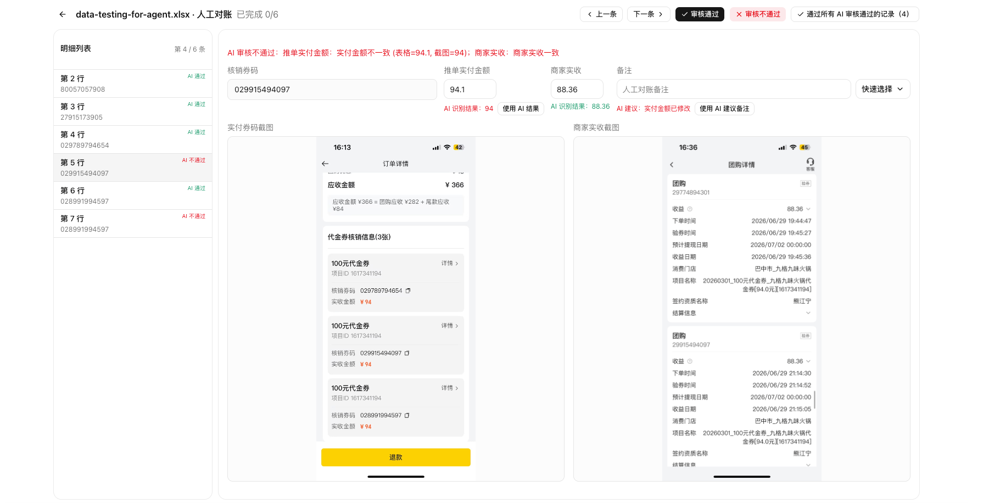

# 财务助手使用说明

财务助手用于批量核对 Excel 表格中的实付、商家实收截图及金额。系统会调用本地 OCR 读取图片信息并给出初步结果；**自动化仅用于初筛，最终结果必须经人工逐条检查确认。**

## 开始前准备

首次使用请点击右上角 **设置**：

1. 在“模型”页选择模型，推荐对账使用默认的 `v5_server`。
2. 点击“下载当前模型”，等待状态显示模型文件已就绪。下载完成后，模型路径会自动保存。
3. 保持 Node.js 为“内置”即可；若 OCR 运行异常，可切换“自定义”，再点击“识别系统 Node.js”。

> 对账任务必须先下载 `v5_server` 模型；并发数越高处理越快，同时会占用更多内存，通常保持默认值即可。

## 完成一次对账

1. 在主界面点击 **下载示例表格**，参考示例准备 `.xlsx` 文件及其中引用的截图。
2. 点击 **上传表格**，或直接把 `.xlsx` 文件拖到虚线区域。系统会在后台创建任务并自动刷新进度。
3. 在任务列表查看状态、通过/不通过数量、耗时和当前模型配置。可按状态筛选、刷新，或打开“显示归档”查看历史任务。
4. 点击任务文件名进入详情；任务结束后点击 **开始对账**，进入人工复核界面。
5. 在任务详情点击 **下载结果**，获取已包含对账结果的表格。完成且无需日常查看的任务可归档；删除任务会移除该任务数据，请谨慎操作。

## 核心功能：人工对账

自动审核可能受到截图模糊、金额展示格式、订单信息不完整等影响，不能替代人工判断。请以原始截图和业务规则为准，完成每一条记录的复核。

人工对账界面从左到右完成核验：

1. **选择记录**：左侧列表显示每一行的 AI 初审状态；可用顶部“上一条 / 下一条”连续检查。
2. **核对信息**：查看中间的核销券码、推单实付金额和商家实收金额，并与下方两张原始截图逐项比对。
3. **修正与备注**：金额有误可直接修改；需要说明原因时填写“人工对账备注”，或从“快速选择”中选用常见原因。AI 识别金额和建议备注仅作参考，可按需点击“使用 AI 结果”。
4. **确认结论**：核验无误点击 **审核通过**；发现问题点击 **审核不通过** 并说明原因。完成一条后继续检查下一条，直至列表全部处理完毕。

> “通过所有 AI 审核通过的记录”适合已完成抽查、确认规则无误后的批量确认；对金额敏感或异常较多的任务，建议逐条人工审核。

## 结果怎么理解

| 状态 | 含义 |
| --- | --- |
| 通过 | 经人工确认金额、截图信息符合预期。 |
| 不通过 | 人工发现截图、金额、订单号等不匹配；应填写原因。 |
| 跳过 | 该条不参与自动判断，需要按业务规则处理。 |
| 已完成 | 整个表格的 OCR 与自动审核已结束，可进入人工对账。 |

## 小提示

- 仅支持 `.xlsx` 文件；上传前可先用“下载示例表格”确认列与图片组织方式。
- 截图越清晰，OCR 结果越可靠；遇到疑似异常条目，应以原始截图为准进行人工确认。
- 在设置的“调试”页可单独上传一张图片测试 OCR；仍有问题时可打开日志文件夹，将错误日志提供给技术支持。
